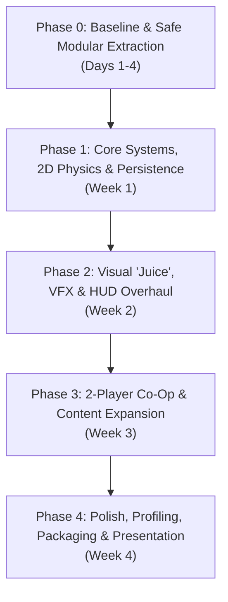

# 🚀 NEO NOVA: Comprehensive Improvement Plan & Group Project Roadmap

> **Target Audience:** Group Project of 3 Developers (Academic / Portfolio)  
> **Project Scope:** High-Octane 2D Space Shooter (C++, OpenGL, FreeGLUT, Procedural Audio)  
> **Document Goal:** Provide actionable, high-impact improvements to gameplay, user experience (UX), visual aesthetics, software architecture, and team collaboration.

---

## 👥 3-Developer Role Allocation Matrix

To prevent merge conflicts and ensure clear grading accountability, the project is structured into three specialized domains:

```text
┌────────────────────────────────────────────────────────────────────────┐
│                        NEO NOVA DEVELOPMENT TEAM                       │
├─────────────────────┬──────────────────────────┬───────────────────────┤
│    DEVELOPER 1      │       DEVELOPER 2        │      DEVELOPER 3      │
│  Systems & Engine   │   Gameplay & Combat AI   │    UX, UI & Economy   │
├─────────────────────┼──────────────────────────┼───────────────────────┤
│ • Modular Refactor  │ • 2-Player Local Co-Op   │ • Save/Load System    │
│ • Full 2D Physics   │ • Enemy AI & Formations  │ • In-Run Upgrade Shop │
│ • VFX & Particles   │ • Multi-Stage Bosses     │ • Floating Combat HUD │
│ • Delta-Time Engine │ • 3 Ship Archetypes      │ • Audio & Gamepad     │
└─────────────────────┴──────────────────────────┴───────────────────────┘
```

---

## 🛠️ Category 1: Architecture & Codebase Refactoring
*(Primary Owner: Developer 1 | Support: Developer 2 & 3)*

Currently, the entire game resides inside a single 3,400+ line monolithic `main.cpp`. For a 3-person team, this creates constant Git merge conflicts. The first critical improvement is modularizing the codebase.

### 1.1 Modular File Structure
Split `main.cpp` into clean, single-responsibility modules:

```text
2D-Space-Shooter/
├── include/
│   ├── Core/
│   │   ├── Engine.hpp          # Game loop, state manager, timing (delta time)
│   │   ├── Config.hpp          # Window settings, constants, key mappings
│   │   └── Input.hpp           # Keyboard, mouse, and gamepad pollers
│   ├── Entities/
│   │   ├── Entity.hpp          # Base entity (position, velocity, bounding box)
│   │   ├── Player.hpp          # Player 1 & Player 2 controllers, health, powerups
│   │   ├── Enemy.hpp           # Swarmers, Snipers, Heavy Cruisers
│   │   ├── Boss.hpp            # Multi-turret, phased boss classes
│   │   ├── Projectile.hpp      # Lasers, plasma balls, homing missiles
│   │   └── Powerup.hpp         # Drops, floating physics, pickup collision
│   ├── Graphics/
│   │   ├── Renderer.hpp        # Geometry drawing primitives & batching
│   │   ├── ParticleSystem.hpp  # Spark, smoke, debris, warp trails
│   │   └── Starfield.hpp       # Parallax nebula and multi-depth starfields
│   ├── Audio/
│   │   └── SoundEngine.hpp     # WinMM thread, sound synthesis, BGM sequencer
│   └── UI/
│       ├── HUD.hpp             # Health bars, combo meters, radar minimap
│       ├── Menu.hpp            # Main menu, pause modal, settings, shop
│       └── SaveSystem.hpp      # Persistent high scores, achievements, save files
├── src/
│   ├── main.cpp                # Lightweight entry point (~60 lines)
│   ├── ... (matching .cpp implementations)
```

### 1.2 True Delta-Time Frame Independence
- **Current Issue:** Movement is tied to fixed timer ticks (`glutTimerFunc(16, ...)`), which causes jitter on monitors with refresh rates > 60Hz.
- **Improvement:** Calculate elapsed delta time (`dt = (currentTime - lastTime) / 1000.0f`) using `std::chrono::high_resolution_clock`. All movement equations become `position += velocity * dt`, making physics buttery smooth on 60Hz, 120Hz, 144Hz, and 240Hz screens.

---

## 🎮 Category 2: Core Gameplay & Combat Expansion
*(Primary Owner: Developer 2 | Systems Support: Developer 1)*

### 2.1 Full 2D Omnidirectional Movement (X and Y Axis)
- **Current Limitation:** The player is constrained to horizontal X-axis movement along the bottom margin.
- **Improvement:** 
  - Allow full vertical and horizontal maneuvering across the lower 60% of the screen.
  - Implement **inertia and thruster physics**: Ships drift slightly when releasing keys, with reactive afterburner particles flaring dynamically during acceleration.
  - Add a **Dodge Roll / Tactical Dash** (`Shift` or `Double Tap` direction) granting 0.3s of invulnerability frames (i-frames) with cooldown.

### 2.2 2-Player Local Co-Op Mode (Crucial for 3-Person Team Demo)
- **Feature Overview:** A dedicated two-player cooperative defense mode.
- **Player 1 Controls:** `W/A/S/D` to move, `Space` to shoot, `Q` for EMP Bomb.
- **Player 2 Controls:** `Arrow Keys` to move, `Numpad 0` / `Enter` to shoot, `Right Shift` for EMP Bomb.
- **Co-Op Mechanics:**
  - **Shared Combo Multiplier:** Simultaneous hits by both players escalate score multipliers up to 10x.
  - **Shield Tether / Synergy:** Staying close to your wingman grants passive shield regeneration.
  - **Emergency Revive:** If Player 1 is shot down, an escape capsule drifts; Player 2 can collect it to revive them with 50% hull integrity.

### 2.3 3 Distinct Playable Ship Archetypes
Let players choose a vessel tailored to different playstyles at the start of a mission:

| Ship Archetype | Strengths | Trade-Offs | Special Ability |
| :--- | :--- | :--- | :--- |
| **Vanguard Interceptor** | Highest movement speed, rapid fire rate | Lowest hull (3 HP), narrow laser cone | **Overdrive**: +100% fire rate for 5 seconds |
| **Aegis Dreadnought** | Heavy hull (6 HP), innate forcefield absorption | Slower turn rate, larger hitbox | **Plasma Shield**: Frontal barrier that reflects lasers back at enemies |
| **Mirage Gunship** | Dual auto-seeking micro-missiles | Moderate speed and hull (4 HP) | **EMP Warp**: Blinks forward 150px, clearing surrounding projectiles |

### 2.4 Multi-Phase Boss Battles with Destructible Subsystems
- **Current State:** Bosses are single targets with a monolithic health bar.
- **Improvement:** Bosses feature distinct, targetable components:
  - **Left & Right Turret Batteries:** Can be focused down to disable flanking laser barrages.
  - **Shield Core Generator:** Emits an energy barrier until destroyed.
  - **Enrage / Final Phase:** When hull drops below 25%, the capital ship vents fire particles, boosts attack speed, and fires sweeping orbital beam lasers.

---

## 🎨 Category 3: Visual Polish & "Game Feel" (Juice)
*(Primary Owner: Developer 1 | UI Support: Developer 3)*

Game feel separates a student prototype from a polished, satisfying commercial-feeling indie title.

### 3.1 Impact Feedback & Combat "Juice"
- **Hit Stop (Micro-Freeze):** When a heavy enemy or boss takes explosive damage, freeze the frame for 30–50 milliseconds. This gives weapons immense perceived weight and impact.
- **Dynamic Directional Screen Shake:** Shake the viewport along the collision vector when taking damage or detonating bombs (scaling from subtle rumble to explosive shockwave).
- **Muzzle Flashes & Screen Flash:** Quick 1-frame translucent white/amber flash over the screen on massive capital ship detonations.
- **Damage Numbers & Floating Combat Text:** Popping combat text (`"CRIT 450"`, `"-1 SHIELD"`, `"OVERDRIVE!"`) drifting upward and fading out.

### 3.2 Advanced Particle FX
- **Thruster Trails:** Gradient particle ribbons that curve realistically as ships pitch and bank.
- **Enemy Debris Physics:** When enemies explode, shatter them into spinning triangular hull fragments with random velocities and fading trails.
- **Dynamic Starfield & Space Dust:** 3 distinct parallax layers of stars moving at different speeds, with cosmic dust clouds and distant planetary silhouettes rotating in the background.

---

## 🖥️ Category 4: User Experience (UX), Menus & Progression
*(Primary Owner: Developer 3 | Gameplay Support: Developer 2)*

### 4.1 In-Run Hangar & Scrap Upgrade Shop
- **Core Loop:** Destroyed enemies drop glowing green/gold **Scrap Metal** pods.
- **Between-Sector Hangar Screen:** Between Sector jumps, players spend accumulated Scrap on permanent or run-based upgrades:
  - Max Hull Integrity (+1 HP container)
  - Blaster Cooling Rate (Reduces weapon overheat)
  - Drone Companion (Purchasable automated wingman drone that fires at nearest threats)
  - Magnet Module (Pulls power-ups and scrap toward the ship from greater distances)

### 4.2 Comprehensive HUD Overhaul
- **Threat Detection Radar (Mini-Map):** A circular or rectangular radar widget in the corner displaying off-screen incoming enemy blips and boss positions.
- **Off-Screen Target Arrows:** Pulsing red indicator arrows at the screen edge warning the player of diving enemies or incoming homing ordnance.
- **Combo Meter & Multiplier:** An escalating combo gauge (`x2`, `x3`, `x5`, `x10`) that drains if no enemy is hit for 3.5 seconds.
- **Cooldown Timers:** Sleek circular sweep icons showing remaining durations for Active Shields, Triple Spread, and Warp Thrusters.

### 4.3 Persistent Save / Load System
- Save game data locally to a structured file (`savegame.dat` or `savegame.json`):
  - **Top 10 High Scores Table** (Score, Sector Reached, Pilot Name, Date)
  - **Player Lifetime Stats** (Total Ships Destroyed, Accuracy %, Bosses Defeated, Time Flown)
  - **Unlocked Ships & Visual Paint Schemes**
  - **Persistent Audio & Accessibility Settings**

### 4.4 Accessibility & Input Flexibility
- **Full Gamepad / Controller Support:** Support standard XInput / Xbox / PlayStation controllers (Left Stick for movement, Right Trigger to fire, `(A)` for Bomb, `Start` to pause).
- **Custom Key Rebinding:** In-game Settings menu allowing players to rebind all primary and secondary actions.
- **Colorblind Palettes:** Toggleable high-contrast color modes for hostile lasers vs. friendly projectiles.

---

## 🎵 Category 5: Dynamic Sound Design
*(Primary Owner: Developer 3 | Systems Support: Developer 1)*

### 5.1 Interactive Audio Enhancements
- **Low-Pass Filter on Pause & Low Health:** When game is paused or hull is reduced to 1 HP, apply a muffled low-pass filter to the synthesizer, mimicking ear-ringing shock.
- **Stereo Panning:** Explosions on the left side of the screen play louder in the left audio channel; lasers fired from right wingtips pan right.
- **Adaptive Music Layers:** Boss music adds an extra aggressive drum/lead layer that kicks in when the boss enters its enraged phase.

---

---

## 📅 Phased Execution Guide: Step-by-Step Implementation

To keep the game functional at every stage and ensure all 3 developers can work in parallel without blocking each other, execute the enhancements across **5 structured phases**.



---

### 🟢 Phase 0: Baseline Setup & Safe Modular Extraction (Days 1–4)
> **Goal:** Break the 3,429-line monolithic `main.cpp` into clean, compile-ready modules **without breaking existing gameplay**.

#### Step 0.1: Git Repository & Branching Baseline
1. Lock the baseline `main` branch with the current working game.
2. Create a shared integration branch `develop`.
3. Set up `.gitignore` to ignore `game.exe`, `*.o`, `*.obj`, `.vscode/`, and build artifacts.
4. Agree on a common directory layout (`include/`, `src/`).

#### Step 0.2: Incremental File Extraction Order
Do **not** try to split all 3,400 lines at once. Extract in this safe, self-contained order:

1. **Extract Sound System (Developer 3)**:
   - Move WinMM synthesizer, `SfxVoice`, `audioThread`, and sound enums into `include/Audio/SoundEngine.hpp` and `src/Audio/SoundEngine.cpp`.
   - *Verification:* Compile with `.\build.bat`. Ensure all sound effects and background music play normally.
2. **Extract Configuration & Types (Developer 1)**:
   - Move constants (`WIDTH`, `HEIGHT`), `GameState` enum, `ScreenShakeLevel`, and ship colors into `include/Core/Config.hpp`.
3. **Extract Entities (Developer 2)**:
   - Create `include/Entities/Entity.hpp`, `Player.hpp`, `Enemy.hpp`, `Boss.hpp`, `Projectile.hpp`, and `Powerup.hpp`.
   - *Verification:* Compile and confirm collision detection, player movement, and enemy waves function identically.
4. **Extract Renderer & UI (Developer 1 & 3)**:
   - Move OpenGL immediate mode primitives, text rendering (`renderBitmapString`), starfields, and menus into `include/Graphics/Renderer.hpp` and `include/UI/Menu.hpp`.
5. **Slim Down `main.cpp` (All Developers)**:
   - `main.cpp` now only contains `main()`, GLUT initialization, and calls to `Engine::Update()` and `Engine::Render()`.

> **Phase 0 Exit Gate:** The game builds cleanly with multiple translation units via `.\build.bat`, running identically to the original version.

---

### 🟡 Phase 1: Core Systems, 2D Physics & Persistence (Week 1)
> **Goal:** Modernize fundamental engine loops and establish individual feature ownership.

#### Developer 1: Delta-Time & Frame Independence
- [ ] Replace fixed 16ms timer reliance with an elapsed delta-time calculation (`std::chrono::high_resolution_clock`).
- [ ] Update all movement: `x += vx * dt; y += vy * dt;`.
- [ ] Add display mode toggle for Fullscreen / Windowed (`F11`) with aspect ratio preservation.

#### Developer 2: 2D Movement, Inertia & Ship Archetypes
- [ ] Upgrade player movement from 1D (horizontal X-axis only) to **full 2D maneuvering** across the lower 65% of the screen.
- [ ] Add thruster momentum: gradual acceleration and braking drag instead of instantaneous binary stops.
- [ ] Implement the **Tactical Dash / Evade** (`Shift` key) with a 0.3s invulnerability window.
- [ ] Define the `ShipArchetype` data structure and implement 3 playable ships (Interceptor, Dreadnought, Mirage).

#### Developer 3: Persistence & Settings Storage
- [ ] Implement `SaveSystem::SaveHighScores()` and `SaveSystem::LoadHighScores()` writing to `savegame.dat` or `scores.json`.
- [ ] Save audio volume sliders, selected ship color, and screen shake preferences so they persist across game restarts.
- [ ] Add an in-game High Scores Leaderboard screen accessible from the Main Menu.

> **Phase 1 Exit Gate:** Player can select from 3 ships, move smoothly in 2D with momentum across any monitor refresh rate, and scores persist after closing the game.

---

### 🟠 Phase 2: Visual "Juice", VFX & HUD Overhaul (Week 2)
> **Goal:** Transform basic geometric shapes into an intense, arcade-quality audiovisual experience.

#### Developer 1: Particle System & Combat "Juice"
- [ ] Build a generic, high-performance particle pool (`ParticleSystem` with 1,000 pre-allocated particles).
- [ ] Add distinct emitter types:
  - Ship thruster exhaust flames (fading orange/cyan ribbons).
  - Hull spark bursts on projectile deflection.
  - Multi-colored radial blast shockwaves on boss defeat.
- [ ] Implement **Hit-Stop** (micro-freeze of 30–50ms on major impacts) and directional screen shake.

#### Developer 2: Dynamic Enemy Formations & Advanced AI
- [ ] Create specialized enemy archetypes:
  - **Swarmer Drones:** Flocking movement with swooping sine-wave attack runs.
  - **Sniper Corvettes:** Stay at top screen edge and fire fast, telegraphed laser bolts.
  - **Shield Carriers:** Project a protective arc over nearby smaller fighters.
- [ ] Add floating scrap metal / currency pickups dropped by destroyed foes.

#### Developer 3: Tactical HUD & Floating Combat Feedback
- [ ] Implement **Floating Combat Text**: Rising, fading damage numbers (`"-45"`, `"CRIT!"`, `"+100"`).
- [ ] Add a **Radar / Threat Minimap** showing enemy blips and incoming projectiles outside view.
- [ ] Build an animated **Combo Multiplier Gauge** (`x2`, `x3`, `x5`) with decay timers.
- [ ] Display circular visual cooldown timers for active shields and power-up durations.

> **Phase 2 Exit Gate:** Combat feels punchy and weighted; screen shake, particles, damage numbers, and radar provide rich real-time situational feedback.

---

### 🔴 Phase 3: 2-Player Co-Op & Content Expansion (Week 3)
> **Goal:** Deliver the standout headline features that make this project shine in academic evaluations.

#### Developer 2: 2-Player Local Co-Op Mode
- [ ] Add `GameMode` toggle in Main Menu: **Single Player** vs. **2-Player Co-Op**.
- [ ] Split input handling: Player 1 (`WASD` + `Space` + `Q`) and Player 2 (`Arrow Keys` + `Numpad 0` + `Right Shift`).
- [ ] Implement Co-Op synergy mechanics:
  - **Shield Tether:** Flying within 120px of each other slowly recharges shields.
  - **Revival Capsule:** When a player dies, their escape pod drifts; the teammate can pick it up to revive them.
  - **Combined Ult:** Simultaneous bomb detonation creates a screen-wide dual-element storm.

#### Developer 1: Multi-Phase Bosses with Destructible Sub-Systems
- [ ] Refactor Boss classes to support independent child hitboxes:
  - Left & right missile pods can be destroyed individually to disable specific attacks.
  - Energy shield core must be depleted before the hull takes damage.
- [ ] Add an Enrage Phase (< 25% HP): Boss changes color, sirens blare, and attack cadence doubles.

#### Developer 3: In-Run Scrap Upgrade Shop & Controller Support
- [ ] Create the **Between-Sector Hangar Screen**:
  - Spend accumulated scrap on: Extra Hull Container, Fire Rate Boost, Drone Wingman, Magnet Range.
- [ ] Integrate **Gamepad / XInput Support**: Dual-stick controller navigation and trigger firing.
- [ ] Add dynamic low-pass audio filtering (muffled sound) when paused or at critical hull integrity.

> **Phase 3 Exit Gate:** Two players can play simultaneously with gamepads/keyboards, fight multi-part bosses, collect scrap, and buy upgrades in the hangar.

---

### 🟣 Phase 4: Polish, Profiling, Packaging & Presentation (Week 4)
> **Goal:** Eliminate bugs, optimize performance, write final documentation, and prepare the demo presentation.

#### All Developers: Quality Assurance & Optimization
- [ ] **Performance Profiling:** Verify steady 60+ FPS under intense 1,000-particle storms; optimize entity iteration loops.
- [ ] **Static Linking & Standalone Packaging:**
  - Verify that `game.exe` runs on a fresh Windows machine with zero dependencies installed.
  - Ensure `libfreeglut.dll` and runtime libraries are packaged cleanly.
- [ ] **Debug Mode (`F1`):** Toggle display of hitboxes, current FPS, entity counts, and delta time for grading evaluation.

#### Team Roles for Final Submission & Grading Demo

| Developer | Academic Focus Area | Demo Presentation Role |
| :--- | :--- | :--- |
| **Developer 1** | Software Architecture, Modern OpenGL, Particle Math | Demonstrates the modular refactor, delta-time physics, and particle emitters. |
| **Developer 2** | AI Algorithms, Collision Systems, Co-Op Networking/Logic | Live-demos 2-Player Co-Op, Boss sub-system destruction, and enemy pathing. |
| **Developer 3** | UI/UX Design, Sound Synthesis, Persistent Data Structures | Showcases the Hangar Shop, Save/Load data, Gamepad support, and audio filters. |

---

## 🔀 Git Collaboration Guidelines for 3 Developers

To prevent overwriting each other's work:

1. **Branch Naming Standard:**
   - `feature/dev1-modular-refactor`
   - `feature/dev2-coop-mode`
   - `feature/dev3-hangar-shop`
   - `bugfix/issue-description`
2. **Pull Request (PR) Policy:**
   - Never commit directly to `main` or `develop`.
   - Every PR requires **at least one teammate's code review approval** before merging into `develop`.
   - Run `.\build.bat run` locally before opening a PR to guarantee the build is never broken.
3. **Module Ownership Rule:**
   - If you need to edit a file primarily owned by another teammate (e.g., editing `Renderer.hpp` while working on UI), coordinate in chat or pair-program to avoid merge collisions.

---

## 💡 Quick-Win Checklist (High Value, Low Effort)

If your team needs immediate improvements before an upcoming milestone:
- [x] **Fix PowerShell Launching:** Add explicit support for `.\build.bat run` and static GCC linking (`-static-libgcc -static-libstdc++`).
- [ ] **Persistent High Scores:** Save the top 5 scores to `highscore.txt` so records don't vanish on game exit.
- [ ] **Screen Shake Polish:** Hook existing screen shake to enemy explosions, not just player damage.
- [ ] **Visible Hitboxes:** Add a toggleable debug mode (`F1`) displaying bounding boxes and hit circles.
- [ ] **Floating Score Popups:** Render `+100`, `+500` text above dying enemies that fades out over 0.5s.

